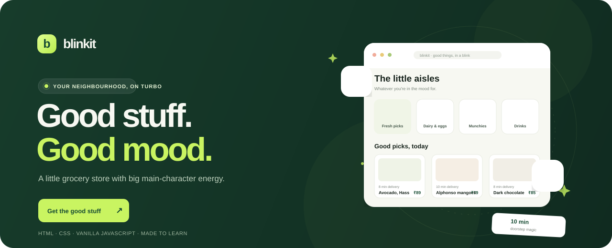

<div align="center">



# blinkit ✳ good things, in a blink

### A tiny grocery store with big main-character energy.

An independent, one-page Blinkit-inspired storefront. Made to learn, made with care, and made a little more fun than a list of products probably needs to be.

<a href="https://xc0d3f4th3r.github.io/BLINKIT-CLONE/"><strong>✦ OPEN THE LIVE STORE ✦</strong></a>
&nbsp;&nbsp;·&nbsp;&nbsp;
<a href="#-run-it-yourself">Run it yourself</a>
&nbsp;&nbsp;·&nbsp;&nbsp;
<a href="https://github.com/xC0D3F4TH3R/BLINKIT-CLONE">Explore the code</a>

<br><br>


</div>

<br>

> **A note from the developer:** This is a learning project, not the official Blinkit app. It is a small attempt to make a familiar shopping experience feel warm, playful, and a little bit mine.

## ✳ A little tour

| The fun bits | What they do |
|:--|:--|
| **Find your aisle** | Pick a category or search by product name, type, or description. |
| **Build a little haul** | Add products, change quantities, and see your item count and total update instantly. |
| **Save it for later** | Tap the heart to favourite the things you want to come back to. |
| **Shop the happy prices** | Flip the deal switch to filter the shelf to finds under ₹99. |
| **Let the store pick** | Hit **Surprise me** to add a random product from your current selection. |
| **Check the delivery math** | The cart updates delivery charges and unlocks free delivery at ₹199. |
| **Take it on the go** | The layout reshapes for smaller screens, with a handy mobile cart button. |
| **Find your way around** | Press `Ctrl + K` (or `⌘ + K` on Mac) to jump straight to search. |

<br>

## ✨ A closer look

<table>
<tr>
<td width="50%" valign="top">

### The storefront

A calm, leafy colour palette, a sticky search bar, floating produce, delivery-time labels, and product cards with their own little personalities. Everything lives on one page—no framework, setup wizard, or pile of dependencies required.

</td>
<td width="50%" valign="top">

### The cart

Open the cart to see your items, adjust quantities, check the running total, and watch the delivery fee update. Checkout, login, and the delivery location are friendly demo interactions; no payment or account details are collected.

</td>
</tr>
</table>

## 🧺 Run it yourself

No install. No build. No `npm install`. Just the store.

**Option 1 — Open the page:** Download or clone the repository, then open `index.html` in a browser.

**Option 2 — Use VS Code:** Open the folder and launch `index.html` with the Live Server extension.

**Option 3 — Start a tiny local server:**

```bash
python -m http.server 8000
```

Then visit [http://localhost:8000](http://localhost:8000).

## 🛠️ Under the hood

- **HTML** for the storefront and accessible page structure
- **CSS** for the responsive layout, product cards, drawer, and little animations
- **Vanilla JavaScript** for search, categories, favourites, deals, and cart state
- **Unsplash** for product photography and **Google Fonts** for type

There is deliberately no framework or dependency list. The whole experience starts in [`index.html`](./index.html).

## 🌱 What's next?

This is a work in progress, just like learning to build things always is. A real product API, saved carts, and a proper checkout would be fun next steps. For now, the data lives in the page and the checkout is only a demo.

Found something wonky? Have an idea? Issues and kind suggestions are very welcome.

## 🚀 Put it on the internet

This repository includes a GitHub Actions workflow that publishes the static storefront to GitHub Pages on every push to `main`.

1. Open **Settings → Pages** in the repository.
2. Set the build and deployment source to **GitHub Actions** if it is not already selected.
3. Check the **Actions** tab for the first deployment.
4. Say hello to your live store: **[xc0d3f4th3r.github.io/BLINKIT-CLONE](https://xc0d3f4th3r.github.io/BLINKIT-CLONE/)**.

<div align="center">

<br>

**Built slowly, learned a lot, enjoyed the little details.**
Made with ☕, curiosity, and probably one too many grocery emojis.

</div>
